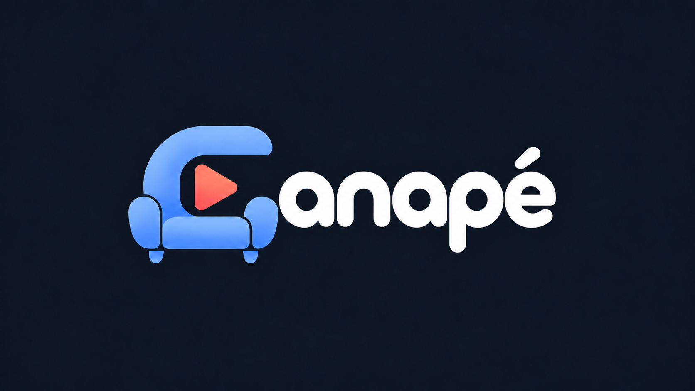
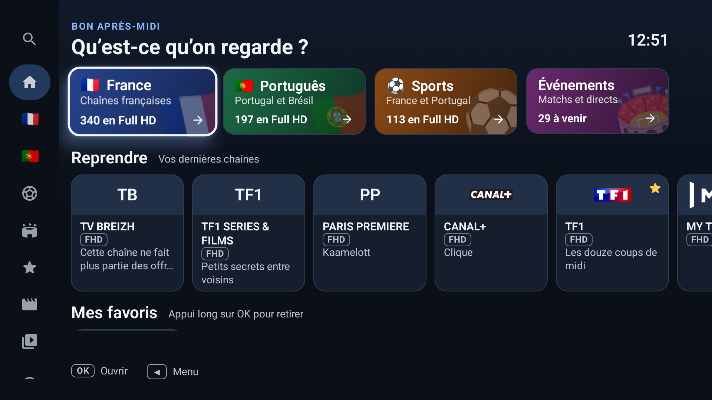
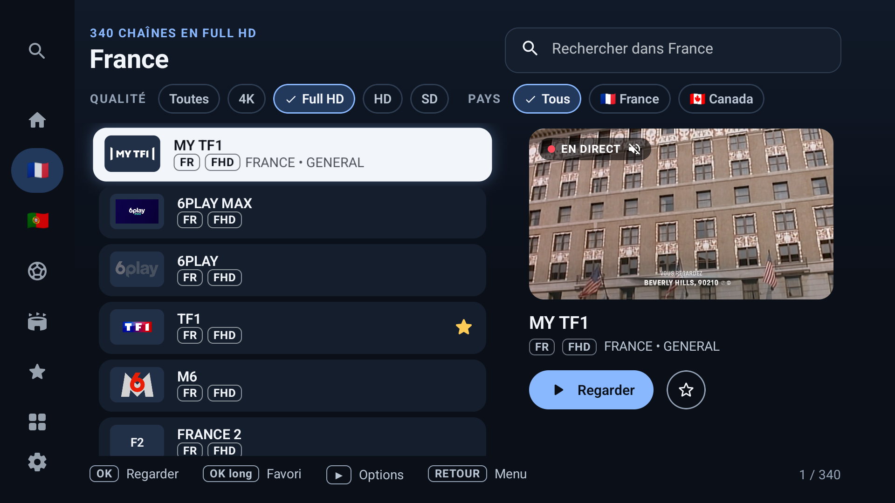
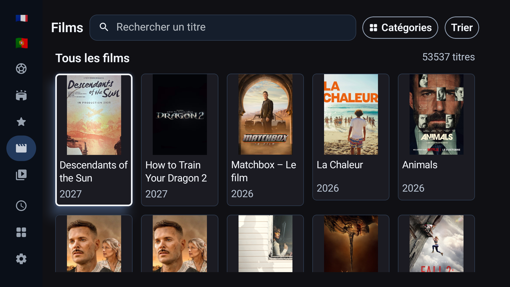
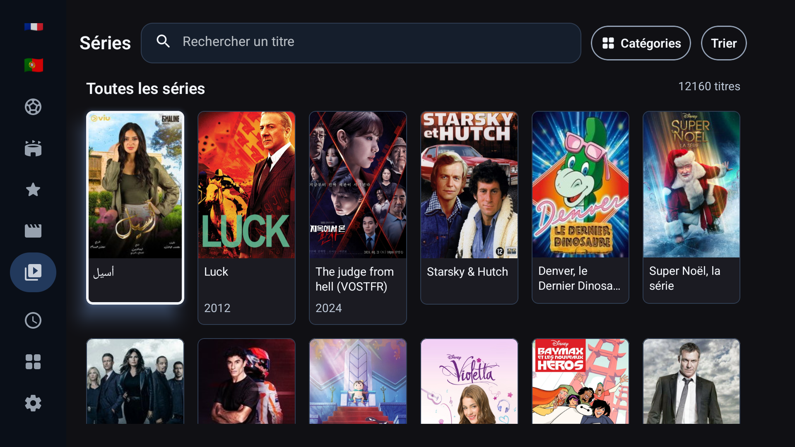
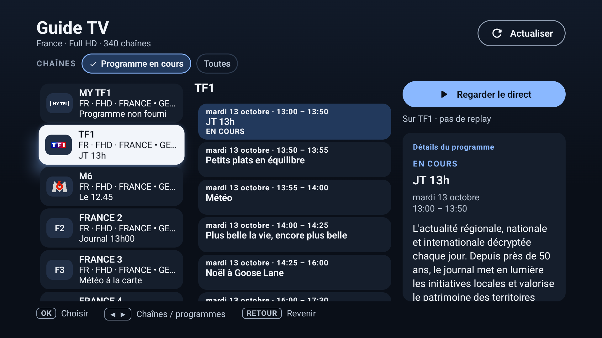
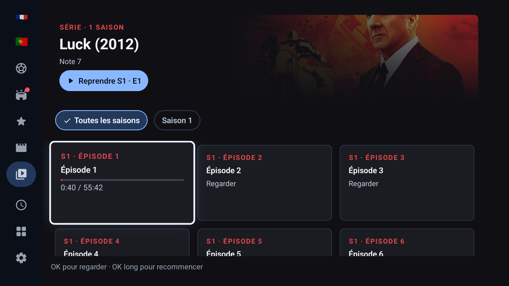
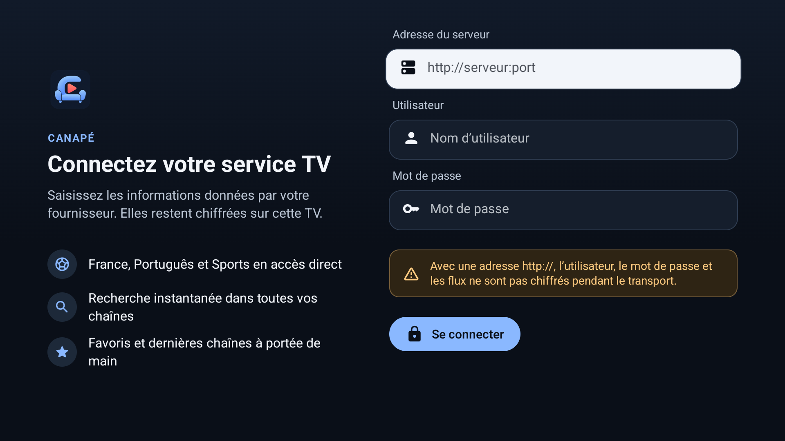

<p align="center">
  
</p>

# Canapé

<p align="center">
  <strong>Your next watch starts on the sofa.</strong><br>
  Live TV, films, and series. One remote. One place to settle in.
</p>

<p align="center">
  <a href="https://github.com/anthonymq/canape/releases/latest"><strong>Download for Google TV</strong></a>
  · <a href="#install-with-downloader">Install with Downloader</a>
  · <a href="#take-a-look">Screenshots</a>
  · <a href="#build-it-yourself">Build from source</a>
</p>

<p align="center">
  
  
  
  <a href="https://github.com/anthonymq/canape/releases/latest"></a>
</p>



**Less searching. More watching.** Canapé turns your Xtream service into a native Google TV experience: jump into your favorite channels, preview what's playing, browse a poster library, or pick up the episode you left halfway through.

Built for the sofa, with a French interface, readable text, visible focus, and navigation designed around the TV remote.

> **Bring your own service.** Canapé is a player. You need an Xtream server address, username, and password from your service. Channels, films, series, artwork, and programme schedules come from that service; none are bundled with the app.

## Make yourself comfortable

| When you want to… | Canapé gets you there |
| --- | --- |
| **Find something live** | Open France, Português, Sports, or Événements straight from Home. |
| **See before you switch** | Browse channels beside a muted live preview; press OK to go full screen. |
| **Skip the endless scrolling** | Search your catalog and narrow live channels by country or quality. |
| **Keep your regulars close** | Save favorite channels, pin categories to Home, and revisit recent channels. |
| **Make it a movie night** | Browse poster grids, search titles, filter categories, and sort by title or year. |
| **Watch one more episode** | Choose a season, see episode progress, and resume where you stopped. |
| **Know what's on next** | Open the TV guide for current programmes, schedules, and details. |

## Install with Downloader

**No computer needed.** On your Google TV or Android TV:

1. Install **[Downloader by AFTVnews](https://play.google.com/store/apps/details?id=com.esaba.downloader)** from Google Play.
2. Open Downloader, enter code **`1089349`**, and select **Go**.
3. Allow Downloader to install unknown apps when your TV asks, then choose **Install**.
4. Open **Canapé**, enter your Xtream service details, and choose **Se connecter**.

**Short URL:** [aftv.news/1089349](https://aftv.news/1089349)

The code and short URL point to the latest published APK. You can also use the direct download address:

```text
https://github.com/anthonymq/canape/releases/latest/download/canape-google-tv.apk
```

**Requirements:** Android 6.0 or newer, a TV remote, an internet connection, and your own Xtream service account. Available content and playback support depend on your service and device.

<details>
<summary><strong>Prefer ADB? Install from your computer.</strong></summary>

Download `canape-google-tv.apk` from the [latest release](https://github.com/anthonymq/canape/releases/latest), connect to your TV using ADB, and run:

```bash
adb install -r canape-google-tv.apk
```

Release APKs use the same signing key. Later versions can update Canapé while keeping your saved account and preferences.

If you previously installed an **Easy IPTV debug build**, uninstall it before installing Canapé's signed release. That one-time uninstall removes the old app's saved account and preferences.

</details>

## Take a look

### Find your channel. Keep the picture.

Search and filters stay beside the channel list. The live preview is muted and waits for your focus to settle, so browsing doesn't start a new stream on every button press.



### A library worth browsing

Films and series have their own poster grids, title search, category picker, and sorting. Open a film for its synopsis and playback actions; open a series for its seasons and episodes.

<table>
  <tr>
    <td width="50%"><br><strong>Films</strong> — find tonight's watch.</td>
    <td width="50%"><br><strong>Séries</strong> — find your next obsession.</td>
  </tr>
</table>

### Tonight's schedule. Tomorrow's next episode.

The guide shows programmes from your service, with times and details. Episode pages keep season selection and saved progress within reach.

<table>
  <tr>
    <td width="50%"><br><strong>Guide TV</strong> — see what's on and what's next.</td>
    <td width="50%"><br><strong>Episodes</strong> — pick up where you left off.</td>
  </tr>
</table>

**Continuer à regarder** remembers unfinished films and the latest episode of each series across app restarts. Progress is saved on this TV, separately for each service account. Finished titles leave the row; series offer the next episode when available.

<details>
<summary><strong>Your first visit: connect your service.</strong></summary>



Have your server address, username, and password ready. Focus a field and press OK to type. Choose **Se connecter** to load your catalog.

</details>

<sub>Real app captures from a 1080p Google TV emulator. Development captures may differ slightly from the latest release. Catalogs, channel counts, artwork, and programmes shown are examples from a connected service, not content included with Canapé.</sub>

## A few buttons. A lot to watch.

| On your remote | While browsing |
| --- | --- |
| **D-pad** | Move between destinations, lists, posters, and controls. |
| **OK** | Open the focused item or start playback. |
| **Hold OK** | Use the secondary action where offered: favorite a channel, remove a Continue Watching entry, or restart an episode. |
| **Back** | Leave the current view or return from playback to your selection. |

On-screen hints show the actions available for the focused item. Back from details or playback restores your library selection and scroll position.

## Your account stays on your TV

- Account credentials are encrypted locally with **AES/GCM**, using a key held by **Android Keystore**.
- Favorites, pinned categories, recent channels, and watch progress stay on this device. They don't sync between TVs.
- Canapé allows HTTP because some services require it. **HTTP does not encrypt credentials or streams in transit**; the setup screen makes that visible. Use HTTPS when your service supports it.
- Xtream request URLs contain account credentials. Remove credentials and stream URLs before sharing logs or screenshots in an issue.

## A small app with a clear focus

Canapé currently supports live TV, films, series, resume playback, favorites, pinned categories, and provider programme schedules. Recording, catch-up playback, parental controls, and a full EPG grid are outside the current scope.

The app has been tested on a Google TV emulator. Physical TV performance and viewing-distance readability still need testing. Stream availability, seeking, programme coverage, artwork, and preview connection limits depend on your provider.

Found something that gets between you and your next watch? [Open an issue](https://github.com/anthonymq/canape/issues) with your TV model, Android version, Canapé version, and the steps to reproduce it.

## Build it yourself

Native **Kotlin + Jetpack Compose for TV**, with **Media3** playback. You'll need JDK 17 and Android SDK 37.

```bash
git clone https://github.com/anthonymq/canape.git
cd canape
export ANDROID_HOME="$HOME/Library/Android/sdk"
./gradlew testDebugUnitTest assembleDebug
```

Set `JAVA_HOME` to your JDK 17 installation if needed. The debug APK is written to `app/build/outputs/apk/debug/app-debug.apk`. Debug builds use a different signing key from public releases.

| Want to go deeper? | Start here |
| --- | --- |
| Build, emulator, and codebase conventions | [AGENTS.md](AGENTS.md) |
| Product behaviour, verification, and known issues | [PRD.md](PRD.md) |
| Layout, typography, and TV navigation | [DESIGN.md](DESIGN.md) |
| Automated builds and release publishing | [Google TV APK workflow](.github/workflows/google-tv-apk.yml) |

<details>
<summary><strong>Maintainers: publish a signed release.</strong></summary>

Automated signing is configured for this repository. After updating `versionCode` and `versionName` in `app/build.gradle.kts`, commit the changes, push `main`, and push a matching version tag. For example, for a future `0.1.2` release:

```bash
git push origin main
git tag v0.1.2
git push origin v0.1.2
```

The workflow runs unit tests and builds the debug APK before building and publishing the signed release APK. Main-branch and pull-request builds create debug artifacts with 30-day retention; version tags publish `canape-google-tv.apk` on GitHub Releases. Rerunning a tag build replaces that release's APK.

Signing uses Actions secrets `CANAPE_KEYSTORE_BASE64` and `CANAPE_KEYSTORE_PASSWORD`, with `CANAPE_CI_RELEASES=true` and key alias `canape`. Keep a secure backup of the original key and password; replacing the key prevents updates to installed copies. Never commit signing files. The initial local backup is in the ignored `signing/` directory.

For local release builds, set `CANAPE_KEYSTORE_PATH` to the absolute keystore path and `CANAPE_KEYSTORE_PASSWORD` to its password, then run `./gradlew assembleRelease`. Without these variables, the release APK is unsigned.

</details>

---

<p align="center"><strong>Pick a channel. Press play. Settle in.</strong></p>
